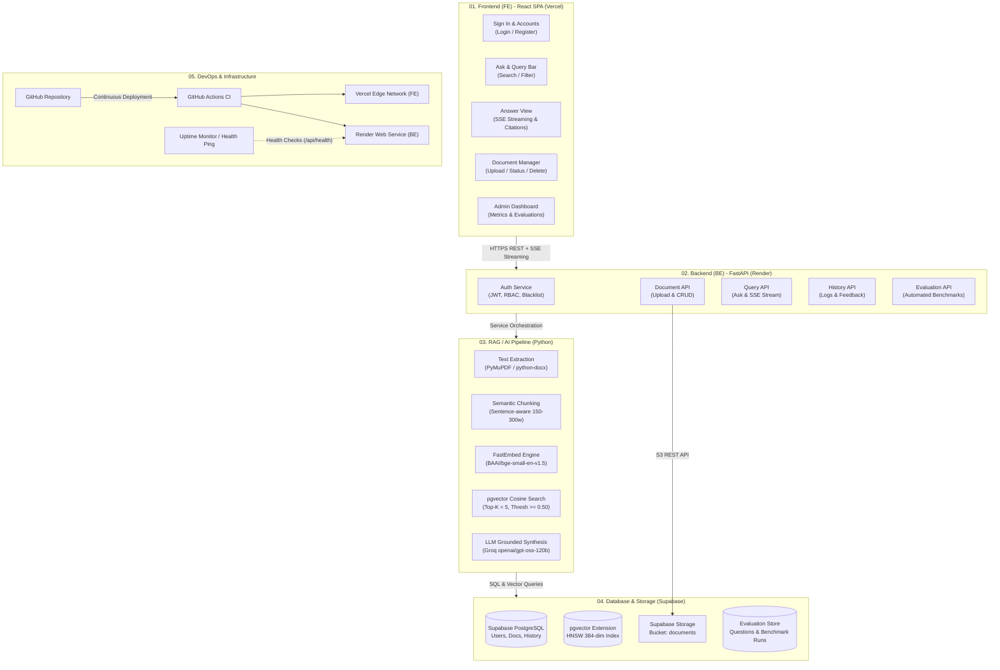
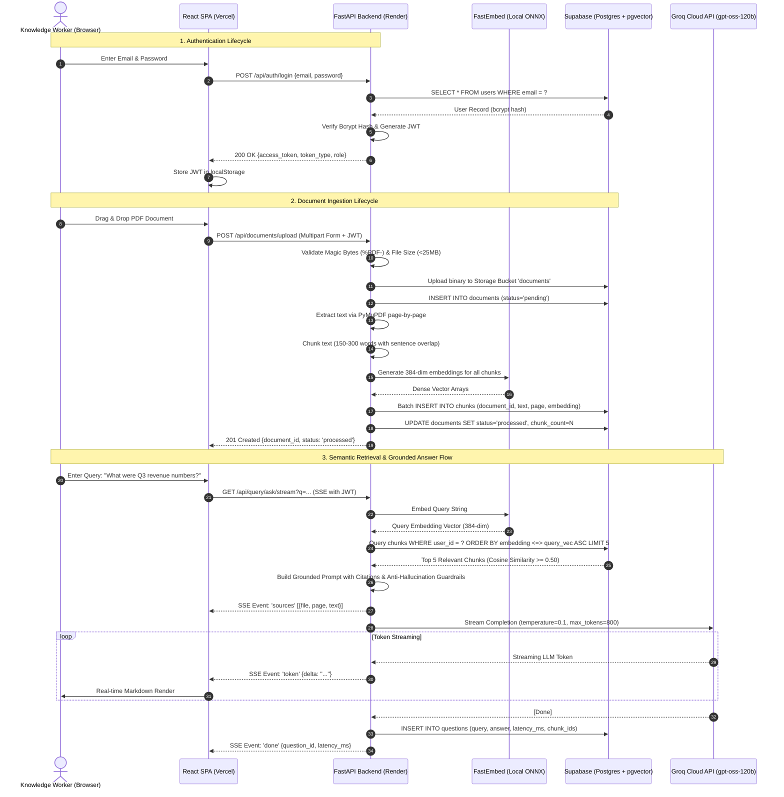
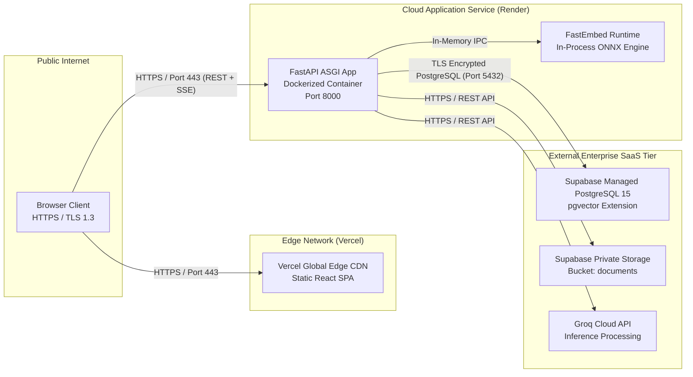

# SEARCHLAB.AI — SYSTEM ARCHITECTURE SPECIFICATION

**Document Version:** 1.0.0  
**Target Audience:** Architects, Lead Developers, DevOps & Security Engineers  
**System Type:** Multi-Tenant Semantic Search & Document Intelligence Platform  

---

## 1. High-Level Modular Architecture

SearchLab.AI is structured into six discrete, loosely coupled modules conforming to the Team 17 Architecture Blueprint:



---

## 2. End-to-End Component Sequence Interaction

The sequence diagram below illustrates the exact request-response lifecycle across the browser, application server, Supabase, FastEmbed, and Groq Cloud:



---

## 3. RAG Pipeline Execution Architecture

```mermaid
flowchart TD
    Q[User Natural Language Query] --> EMB[FastEmbed Local Embedding Generation<br>Model: BAAI/bge-small-en-v1.5]
    EMB --> VEC[384-Dimensional Dense Vector]
    
    VEC --> HNSW[Supabase pgvector HNSW Index Scan<br>Cosine Distance: 1 - embedding <=> query_vec]
    
    subgraph Multi_Tenant_Filter ["Strict Tenant Isolation Boundary"]
        HNSW --> FILTER["Filter WHERE user_id = current_user.id<br>AND document_id IN (optional filter)"]
    end
    
    FILTER --> RANK[Ranked Candidate Chunks]
    
    RANK --> THRESH{Cosine Similarity >= 0.50?}
    THRESH -- No --> REJECT[Discard Chunk]
    THRESH -- Yes --> PASS[Retain Top-5 Context Chunks]
    
    PASS --> CTX_CHECK{Candidate Count > 0?}
    CTX_CHECK -- No --> NO_DATA["Return Grounded Fallback:<br>'I could not find the answer in uploaded documents.'"]
    
    CTX_CHECK -- Yes --> PROMPT["Construct Grounded Prompt:<br>- Enforce Strict Context Constraint<br>- Inject Bracketed Document & Page Citations<br>- Neutralize System Override Instructions"]
    
    PROMPT --> GROQ[Groq Cloud LLM Engine<br>Model: openai/gpt-oss-120b<br>Temperature: 0.1 | Max Tokens: 800]
    
    GROQ --> STREAM[FastAPI Server-Sent Events (SSE) Stream]
    STREAM --> CLIENT[React UI: Live Token Typing & Citation Badges]
```

---

## 4. Network Topology & Deployment Boundaries


