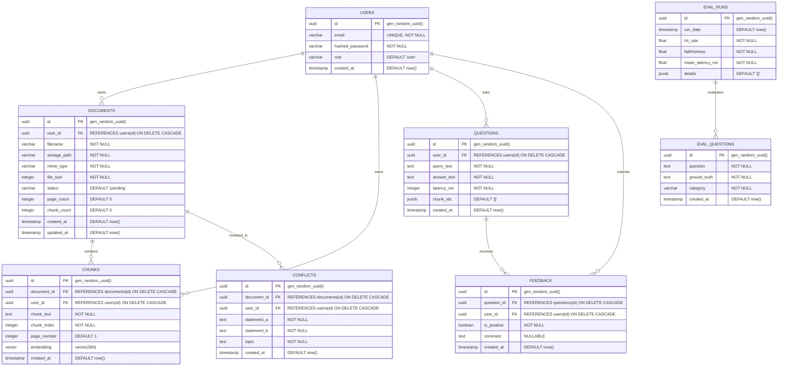

# SEARCHLAB.AI — DATABASE ARCHITECTURE & SCHEMA SPECIFICATION

**Document Version:** 1.0.0  
**Database Engine:** PostgreSQL 15.x (Supabase Managed Instance)  
**Vector Extension:** `pgvector` (0.5.0+)  
**Migration Path:** `backend/migrations/001_initial_schema.sql`  

---

## 1. Entity-Relationship (ER) Diagram

The following Mermaid diagram depicts the complete relational model, primary keys (PK), foreign keys (FK), and cardinality across all 8 database tables:



---

## 2. Table-by-Table Detailed Specifications

### 2.1 `users` Table
Stores authenticated user accounts, roles, and password hashes.

| Column | Data Type | Constraints | Default | Description |
|---|---|---|---|---|
| `id` | `UUID` | PRIMARY KEY | `gen_random_uuid()` | Unique user identifier |
| `email` | `VARCHAR(255)` | UNIQUE, NOT NULL | None | User email address (login credential) |
| `hashed_password` | `VARCHAR(255)` | NOT NULL | None | Salted bcrypt hash of password |
| `role` | `VARCHAR(50)` | NOT NULL | `'user'` | Role-based access level (`user`, `admin`) |
| `created_at` | `TIMESTAMPTZ` | NOT NULL | `now()` | Timestamp of account registration |

---

### 2.2 `documents` Table
Maintains metadata, processing states, and storage pointers for uploaded files.

| Column | Data Type | Constraints | Default | Description |
|---|---|---|---|---|
| `id` | `UUID` | PRIMARY KEY | `gen_random_uuid()` | Unique document identifier |
| `user_id` | `UUID` | FK -> `users(id)` ON DELETE CASCADE | None | ID of document owner |
| `filename` | `VARCHAR(255)` | NOT NULL | None | Sanitized original filename |
| `storage_path` | `VARCHAR(500)` | NOT NULL | None | Relative Supabase Storage path |
| `mime_type` | `VARCHAR(100)` | NOT NULL | None | Detected MIME type (application/pdf, etc.) |
| `file_size` | `INTEGER` | NOT NULL | None | Size in bytes |
| `status` | `VARCHAR(50)` | NOT NULL | `'pending'` | Ingestion status (`pending`, `processed`, `failed`) |
| `page_count` | `INTEGER` | NOT NULL | `0` | Total number of pages extracted |
| `chunk_count` | `INTEGER` | NOT NULL | `0` | Total number of chunks generated |
| `created_at` | `TIMESTAMPTZ` | NOT NULL | `now()` | Creation timestamp |
| `updated_at` | `TIMESTAMPTZ` | NOT NULL | `now()` | Last modification timestamp |

---

### 2.3 `chunks` Table
Contains granular semantic text passages and high-dimensional dense vector embeddings.

| Column | Data Type | Constraints | Default | Description |
|---|---|---|---|---|
| `id` | `UUID` | PRIMARY KEY | `gen_random_uuid()` | Unique chunk identifier |
| `document_id` | `UUID` | FK -> `documents(id)` ON DELETE CASCADE | None | Owning document |
| `user_id` | `UUID` | FK -> `users(id)` ON DELETE CASCADE | None | Document owner (enforces tenant scoping) |
| `chunk_text` | `TEXT` | NOT NULL | None | Normalized text passage (150-300 words) |
| `chunk_index` | `INTEGER` | NOT NULL | None | Sequential zero-based chunk index |
| `page_number` | `INTEGER` | NOT NULL | `1` | One-based source page number |
| `embedding` | `vector(384)` | NULLABLE | None | FastEmbed `bge-small-en-v1.5` dense vector |
| `created_at` | `TIMESTAMPTZ` | NOT NULL | `now()` | Ingestion timestamp |

---

### 2.4 `questions` Table
Audit log and history for user search queries and generated answers.

| Column | Data Type | Constraints | Default | Description |
|---|---|---|---|---|
| `id` | `UUID` | PRIMARY KEY | `gen_random_uuid()` | Unique question record identifier |
| `user_id` | `UUID` | FK -> `users(id)` ON DELETE CASCADE | None | User who executed search |
| `query_text` | `TEXT` | NOT NULL | None | Natural language query entered by user |
| `answer_text` | `TEXT` | NOT NULL | None | Full grounded response generated by LLM |
| `latency_ms` | `INTEGER` | NOT NULL | None | End-to-end execution time in milliseconds |
| `chunk_ids` | `JSONB` | NOT NULL | `'[]'::jsonb` | Array of chunk UUIDs utilized as context |
| `created_at` | `TIMESTAMPTZ` | NOT NULL | `now()` | Query timestamp |

---

### 2.5 `feedback` Table
Captures user satisfaction feedback for answers.

| Column | Data Type | Constraints | Default | Description |
|---|---|---|---|---|
| `id` | `UUID` | PRIMARY KEY | `gen_random_uuid()` | Unique feedback record identifier |
| `question_id` | `UUID` | FK -> `questions(id)` ON DELETE CASCADE | None | Question being evaluated |
| `user_id` | `UUID` | FK -> `users(id)` ON DELETE CASCADE | None | User submitting feedback |
| `is_positive` | `BOOLEAN` | NOT NULL | None | `true` = Thumbs Up, `false` = Thumbs Down |
| `comment` | `TEXT` | NULLABLE | None | Optional textual feedback |
| `created_at` | `TIMESTAMPTZ` | NOT NULL | `now()` | Feedback submission timestamp |

---

### 2.6 `conflicts` Table
Stores detected contradictions between uploaded documents.

| Column | Data Type | Constraints | Default | Description |
|---|---|---|---|---|
| `id` | `UUID` | PRIMARY KEY | `gen_random_uuid()` | Unique conflict identifier |
| `document_id` | `UUID` | FK -> `documents(id)` ON DELETE CASCADE | None | Primary document identifier |
| `user_id` | `UUID` | FK -> `users(id)` ON DELETE CASCADE | None | Tenant owner |
| `statement_a` | `TEXT` | NOT NULL | None | First contradictory excerpt |
| `statement_b` | `TEXT` | NOT NULL | None | Second contradictory excerpt |
| `topic` | `TEXT` | NOT NULL | None | Topic or subject of contradiction |
| `created_at` | `TIMESTAMPTZ` | NOT NULL | `now()` | Detection timestamp |

---

### 2.7 `eval_questions` Table
Curated ground-truth benchmark questions used to evaluate retrieval accuracy and faithfulness.

| Column | Data Type | Constraints | Default | Description |
|---|---|---|---|---|
| `id` | `UUID` | PRIMARY KEY | `gen_random_uuid()` | Unique benchmark question ID |
| `question` | `TEXT` | NOT NULL | None | Benchmark question |
| `ground_truth` | `TEXT` | NOT NULL | None | Reference answer |
| `category` | `VARCHAR(100)` | NOT NULL | None | Test category (e.g. `factual`, `multi-page`, `out-of-scope`) |
| `created_at` | `TIMESTAMPTZ` | NOT NULL | `now()` | Creation timestamp |

---

### 2.8 `eval_runs` Table
Records historical benchmark runs and aggregate evaluation metrics.

| Column | Data Type | Constraints | Default | Description |
|---|---|---|---|---|
| `id` | `UUID` | PRIMARY KEY | `gen_random_uuid()` | Unique evaluation run ID |
| `run_date` | `TIMESTAMPTZ` | NOT NULL | `now()` | Timestamp of benchmark execution |
| `hit_rate` | `FLOAT` | NOT NULL | None | Ratio of benchmark questions with relevant context retrieved |
| `faithfulness` | `FLOAT` | NOT NULL | None | Faithfulness score of generated answers |
| `mean_latency_ms`| `FLOAT` | NOT NULL | None | Average latency across benchmark items |
| `details` | `JSONB` | NOT NULL | `'{}'::jsonb` | Full per-question benchmark results |

---

## 3. Database Indexes

SearchLab.AI incorporates both B-Tree and HNSW vector indexes to maintain high performance under concurrent read and write operations:

```sql
-- 1. B-Tree Indexes for Fast Tenant Lookups & Referential Traversal
CREATE INDEX IF NOT EXISTS idx_documents_user_id ON documents(user_id);
CREATE INDEX IF NOT EXISTS idx_chunks_document_id ON chunks(document_id);
CREATE INDEX IF NOT EXISTS idx_chunks_user_id ON chunks(user_id);
CREATE INDEX IF NOT EXISTS idx_questions_user_id ON questions(user_id);
CREATE INDEX IF NOT EXISTS idx_feedback_question_id ON feedback(question_id);

-- 2. HNSW Vector Index for High-Speed Cosine Similarity Search
CREATE INDEX IF NOT EXISTS idx_chunks_embedding 
ON chunks USING hnsw (embedding vector_cosine_ops) 
WITH (m = 16, ef_construction = 64);
```

### HNSW Parameter Explanation:
- `vector_cosine_ops`: Measures angular distance between 384-dimensional normalized vectors. Cosine distance $= 1 - \cos(\theta)$.
- `m = 16`: Number of bidirectional links created per vector node in the graph, providing a balance between indexing speed and recall accuracy.
- `ef_construction = 64`: Size of the dynamic candidate list evaluated during index construction, guaranteeing >95% recall for Top-K queries.

---

## 4. Referential Integrity & Cascade Deletion

All child tables enforce `ON DELETE CASCADE` across foreign keys. Deleting a record from `users` automatically cascades to delete all corresponding `documents`, `chunks`, `questions`, `feedback`, and `conflicts`. Similarly, deleting a record from `documents` automatically cascades to delete all associated `chunks` and `conflicts` in a single atomic SQL transaction.
