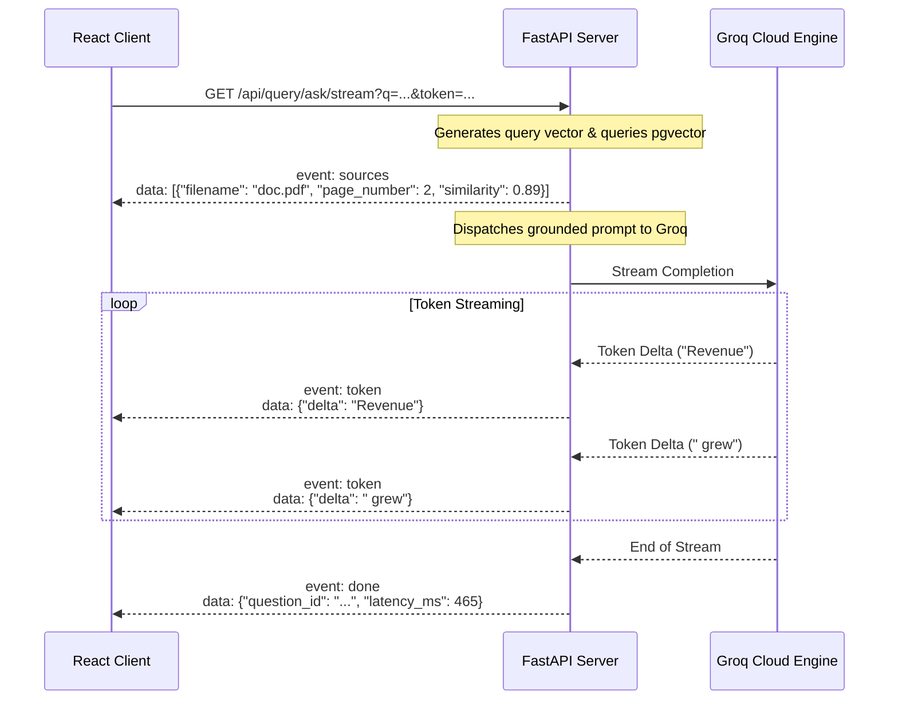

# SEARCHLAB.AI — DATA FLOW & LIFECYCLE SPECIFICATION

**Document Version:** 1.0.0  
**Focus:** Ingestion Pipeline, Vector Retrieval, Token Streaming & Lifecycle State  

---

## 1. Complete Data Storage Mapping

| Category | Storage Provider | Exact Location (Table/Bucket) | Primary Key / Path | Persistence | Multi-Tenant Scoping |
|---|---|---|---|---|---|
| **User Accounts** | Supabase PostgreSQL | `users` table | `id` (UUID) | Persistent | Email uniqueness constraint |
| **User Passwords** | Supabase PostgreSQL | `users.hashed_password` | Scoped to User `id` | Persistent | Salted bcrypt hash |
| **Document Files** | Supabase Storage | Bucket: `documents` | `{user_id}/{doc_id}/{filename}` | Persistent | Path prefixed by user UUID |
| **Document Metadata** | Supabase PostgreSQL | `documents` table | `id` (UUID) | Persistent | Foreign key: `user_id` |
| **Text Chunks** | Supabase PostgreSQL | `chunks` table | `id` (UUID) | Persistent | Scoped by `user_id` & `document_id` |
| **Vector Embeddings** | Supabase PostgreSQL | `chunks.embedding` | Scoped to Chunk `id` | Persistent | 384-dimensional `vector` column |
| **Search Queries** | Supabase PostgreSQL | `questions` table | `id` (UUID) | Persistent | Foreign key: `user_id` |
| **Generated Answers** | Supabase PostgreSQL | `questions.answer_text` | Scoped to Question `id` | Persistent | Logged with latency & source IDs |
| **User Feedback** | Supabase PostgreSQL | `feedback` table | `id` (UUID) | Persistent | Foreign key: `question_id` & `user_id` |
| **Temporary Files** | Local Container FS | `/tmp/` or `app/temp/` | Ephemeral UUID filename | Transient | Deleted within < 1000ms |

---

## 2. Document Ingestion Lifecycle Flow

The ingestion pipeline transforms raw file bytes into indexed dense vectors:

```
[ Step 1: Upload Reception ]
  - Client sends multipart/form-data with file bytes and JWT.
  - Server verifies MIME type and magic bytes:
      * PDF: starts with %PDF-
      * DOCX: starts with PK\x03\x04
      * TXT: valid UTF-8, rejects executable signatures (MZ, ELF).
  - Rejects files > 25MB.

[ Step 2: Object Storage Persistence ]
  - File is uploaded to Supabase Storage:
      Bucket: 'documents'
      Path: '{user_id}/{document_id}/{filename}'
  - Document record inserted with status = 'pending'.

[ Step 3: Text Extraction & Normalization ]
  - PDF: PyMuPDF extracts text per page, recording 1-based page numbers.
  - DOCX: python-docx extracts paragraphs and tables.
  - TXT: Normalized to UTF-8 string.

[ Step 4: Semantic Sentence-Aware Chunking ]
  - Text is tokenized into sentences using punctuation boundaries.
  - Sentences are grouped into chunks of 150-300 words.
  - Overlap of 1-2 sentences is maintained across adjacent chunks to prevent context loss at boundaries.

[ Step 5: Dense Vector Embedding Generation ]
  - Chunks are passed to FastEmbed running `BAAI/bge-small-en-v1.5`.
  - In-process ONNX Runtime produces a 384-dimensional dense vector for each chunk.

[ Step 6: Atomic Database Insertion ]
  - Chunks and vectors are inserted into the `chunks` table in a single batch.
  - The document status is updated to 'processed' and chunk_count is recorded.
```

---

## 3. Query & Retrieval Lifecycle Flow

The retrieval pipeline executes on every user query to produce citation-backed answers:

```
[ Step 1: Query Reception & Embedding ]
  - User submits natural language query.
  - Server embeds the query into a 384-dimensional vector using FastEmbed.

[ Step 2: Vector Search & Thresholding ]
  - A PostgreSQL query calculates cosine similarity:
      1 - (embedding <=> query_vec::vector)
  - Filters strictly by `user_id = current_user.id`.
  - Evaluates similarity score against `RELEVANCE_THRESHOLD = 0.50`.
  - Chunks below 0.50 are filtered out.
  - The top 5 matching chunks are retained.

[ Step 3: Prompt Assembly ]
  - If no chunks pass the threshold, the system returns:
      "I could not find the answer to this question in the uploaded documents."
  - If relevant chunks exist, context blocks are formatted with source metadata:
      [Document: annual_report.pdf, Page: 4]
      "Passage text..."
  - Strict anti-hallucination guardrails and formatting instructions are added.

[ Step 4: Groq Cloud LLM Generation & Token Streaming ]
  - Dispatches assembled prompt to Groq API (`openai/gpt-oss-120b`).
  - Sets temperature = 0.1 for deterministic, factual outputs.
  - Streams tokens back to the client over Server-Sent Events (SSE).

[ Step 5: Audit Logging & Source Verification ]
  - Full question, answer, latency, and utilized chunk IDs are saved to `questions` table.
  - Client receives source citation cards linking each statement to file and page.
```

---

## 4. Server-Sent Events (SSE) Protocol Flow


